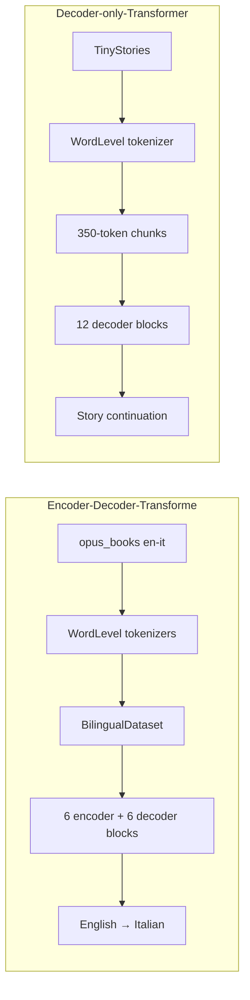

# Transformer From Scratch

From-scratch PyTorch implementations of the Transformer architecture from
[Attention Is All You Need](https://arxiv.org/abs/1706.03762). No pretrained
models and no `nn.Transformer` — embeddings, positional encoding, layer norm,
multi-head attention, residual connections, masking, and the training loops are
all implemented explicitly.

The repository contains two independent projects:

| | [Encoder–Decoder](Encoder-Decoder-Transforme) | [Decoder-only](Decoder-only-Transformer) |
|---|---|---|
| Task | English → Italian translation | Story generation / language modeling |
| Dataset | [`Helsinki-NLP/opus_books`](https://huggingface.co/datasets/Helsinki-NLP/opus_books) `en-it` | [`roneneldan/TinyStories`](https://huggingface.co/datasets/roneneldan/TinyStories) |
| Blocks | 6 encoder + 6 decoder | 12 decoder |
| Attention | Encoder self-attention, decoder self-attention, cross-attention | Causal self-attention only |
| Masks | Padding + causal + cross-attention | Causal |
| Output | `log_softmax` over Italian vocabulary | `log_softmax` over TinyStories vocabulary |
| Decoding | Greedy, `[SOS]` → `[EOS]` | Greedy continuation from a prompt |

## Shared architecture

| Component | Implementation |
|---|---|
| Input embeddings | `nn.Embedding`, scaled by $\sqrt{d_{model}}$ |
| Positional encoding | Sinusoidal, registered as a non-trainable buffer, followed by dropout |
| Attention | Scaled dot-product, $d_k = d_{model}/h$, optional mask |
| Multi-head attention | Separate $W_Q$, $W_K$, $W_V$, $W_O$ projections, `h` heads |
| Feed-forward | Linear → ReLU → Dropout → Linear ($d_{model} \to d_{ff} \to d_{model}$) |
| Residual connection | Pre-norm: `x + dropout(sublayer(norm(x)))` |
| Normalization | Layer norm with learnable scale (`alpha`) and bias (`beta`) |
| Output | Linear projection followed by `log_softmax` |
| Initialization | Xavier uniform on every parameter with `dim > 1` |

Defaults: `d_model=512`, `h=8`, `d_ff=2048`, `dropout=0.1`.
The encoder–decoder builds `N=6` blocks per stack; the decoder-only model uses
`N=12`.



## Repository layout

| Path | Purpose |
|---|---|
| `Encoder-Decoder-Transforme/model.py` | Encoder, decoder, cross-attention, `build_transformer` |
| `Encoder-Decoder-Transforme/dataset.py` | `BilingualDataset`, padding, source/target/causal masks |
| `Encoder-Decoder-Transforme/config.py` | Hyperparameters and checkpoint path helper |
| `Encoder-Decoder-Transforme/train.py` | Tokenizers, data loading, training, greedy decoding, validation, checkpointing |
| `Encoder-Decoder-Transforme/transformer-from-scratch.ipynb` | Self-contained walkthrough including attention heatmaps |
| `Encoder-Decoder-Transforme/attention_visual.ipynb` | Loads the Python modules and a checkpoint to plot attention maps |
| `Decoder-only-Transformer/model.py` | Decoder stack, causal self-attention, `build_transformer` |
| `Decoder-only-Transformer/dataset.py` | 350-token chunk dataset and causal mask |
| `Decoder-only-Transformer/config.py` | Hyperparameters and checkpoint path helper |
| `Decoder-only-Transformer/train.py` | Tokenizer, TinyStories packing, training, greedy generation, validation |
| `Decoder-only-Transformer/transformer-from-scratch-decoder-only.ipynb` | Self-contained walkthrough of the decoder-only variant |
| `resources/` | Supporting diagrams and screenshots |

Each project is self-contained: its `config.py`, `dataset.py`, `model.py`, and
`train.py` are imported by its notebook and run relative to that project
directory.

## Requirements

- **Python 3.12+** for `Encoder-Decoder-Transforme/train.py`, which uses nested
  same-type quotes inside an f-string (`f"{config["lang_src"]}-..."`, PEP 701).
- PyTorch (CPU or CUDA build).
- No lockfile is committed.

```bash
pip install torch datasets tokenizers tensorboard tqdm jupyter
# Notebook extras
pip install altair pandas numpy
```

Install the CUDA build from [pytorch.org](https://pytorch.org/get-started/locally/)
for GPU training.

## Encoder–Decoder: English → Italian translation

```bash
cd Encoder-Decoder-Transforme
python train.py
```

The first run downloads `opus_books` (`en-it`) and trains two `WordLevel`
tokenizers, cached as `tokenizer_en.json` and `tokenizer_it.json`. Each epoch
trains, prints two greedy-decoded validation examples, then writes a checkpoint.
Loss is logged per step.

Artifacts (relative to `Encoder-Decoder-Transforme/`):

- `weights/tmodel_` — latest checkpoint (`epoch`, `model_state_dict`,
  `optimizer_state_dict`, `global_step`)
- `runs/tmodel/` — TensorBoard events (`train_loss`)
- `tokenizer_en.json`, `tokenizer_it.json` — cached tokenizers

```bash
tensorboard --logdir runs/tmodel
```

Notebooks:

```bash
jupyter notebook transformer-from-scratch.ipynb
jupyter notebook attention_visual.ipynb
```

`attention_visual.ipynb` imports `get_ds`, `get_model`, and `greedy_decode` from
the local modules and expects a checkpoint at `weights/tmodel_`.

### Configuration (`Encoder-Decoder-Transforme/config.py`)

| Key | Default | Meaning |
|---|---|---|
| `batch_size` | `16` | Training batch size |
| `num_epochs` | `2` | Training epochs |
| `lr` | `1e-4` | Adam learning rate (`eps=1e-9`) |
| `seq_len` | `350` | Fixed source/target length |
| `d_model` | `512` | Model width |
| `lang_src` / `lang_tgt` | `en` / `it` | Language pair |
| `model_folder` | `weights` | Checkpoint directory |
| `model_basename` | `tmodel_` | Checkpoint filename |
| `preload` | `False` | Resume from `weights/tmodel_` if it exists |
| `tokenizer_file` | `tokenizer_{0}.json` | Per-language tokenizer cache |
| `experiment_name` | `runs/tmodel` | TensorBoard directory |

`N`, `h`, `d_ff`, and `dropout` are not exposed; they use `build_transformer`
defaults.

### Training details

- 90/10 random train/validation split, no fixed seed.
- `WordLevel` tokenizer, whitespace pre-tokenizer, `min_frequency=2`, special
  tokens `[UNK]`, `[PAD]`, `[SOS]`, `[EOS]`.
- Source: `[SOS] … [EOS] [PAD]…`; decoder input: `[SOS] … [PAD]…`; labels:
  tokens shifted right by one position.
- Cross-entropy with `ignore_index=[PAD]` and `label_smoothing=0.1`.
- Greedy decoding over the validation set prints source, target, and prediction.

## Decoder-only: TinyStories language modeling

```bash
cd Decoder-only-Transformer
python train.py
```

The first run downloads TinyStories, trains a `WordLevel` tokenizer
(`tokenizer_.json`), packs the corpus into 350-token chunks, and trains for one
epoch. Validation generates text from a random 12–23-token prompt and prints the
prompt, generation, and decoded ground-truth sequence.

Artifacts (relative to `Decoder-only-Transformer/`):

- `weights/tmodel_` — latest checkpoint
- `runs/tmodel/` — TensorBoard events (`train_loss`)
- `tokenizer_.json` — cached tokenizer

```bash
tensorboard --logdir runs/tmodel
jupyter notebook transformer-from-scratch-decoder-only.ipynb
```

### Configuration (`Decoder-only-Transformer/config.py`)

| Key | Default | Meaning |
|---|---|---|
| `batch_size` | `16` | Training batch size |
| `num_epochs` | `1` | Training epochs |
| `lr` | `1e-4` | Adam learning rate (`eps=1e-9`) |
| `seq_len` | `350` | Packed sequence length |
| `d_model` | `512` | Model width |
| `model_folder` | `weights` | Checkpoint directory |
| `model_basename` | `tmodel_` | Checkpoint filename |
| `preload` | `True` | Resume from `weights/tmodel_` when present |
| `tokenizer_file` | `tokenizer_.json` | Tokenizer cache |
| `experiment_name` | `runs/tmodel` | TensorBoard directory |

### Training details

- TinyStories (`train+validation`) tokenized with `[UNK]` and `[EOS]`, with
  `[EOS]` appended to each story; token streams are concatenated and split into
  exact 350-token chunks, discarding the remainder.
- 90/10 random train/validation split of the chunks, no fixed seed.
- Causal self-attention mask; cross-entropy with `label_smoothing=0.1`.
- Greedy generation appends tokens until `[EOS]` or until the sequence reaches
  325 tokens (a 25-token margin below `seq_len`).

## Notebooks

Both projects ship a self-contained walkthrough notebook with model, dataset,
config, and training code inlined:

```bash
jupyter notebook Encoder-Decoder-Transforme/transformer-from-scratch.ipynb
jupyter notebook Decoder-only-Transformer/transformer-from-scratch-decoder-only.ipynb
```

The encoder–decoder walkthrough also includes attention-map plotting; the
standalone `attention_visual.ipynb` reproduces those plots from a trained
checkpoint. Notebook configs differ from the module configs (for example
`num_epochs=20` and `preload=True` in the encoder–decoder notebook).

## Known limitations

- `get_weights_file_path(config, epoch)` ignores the `epoch` argument and always
  returns `weights/tmodel_` in both projects. Every epoch overwrites the same
  checkpoint, so only the latest survives.
- Runs are not reproducible: neither split nor initialization is seeded.
- No BLEU or other automatic metric — validation only prints decoded samples.
- Decoder-only labels are copies of `input_ids` with no next-token shift, so the
  model is trained to reconstruct the current token rather than predict the next
  one; validation prompts are prefixes of 350-token chunks that may start
  mid-story.
- Decoder-only validation skips samples shorter than 25 tokens and generation is
  capped at 325 total tokens by the `+25` break condition.
- Encoder–decoder training raises `ValueError` for sentences longer than
  `seq_len - 2`, and there is no truncation path.

## Reference

- Vaswani et al., *Attention Is All You Need* (NeurIPS 2017):
  <https://arxiv.org/abs/1706.03762>
- Dataset (translation): <https://huggingface.co/datasets/Helsinki-NLP/opus_books>
- Dataset (stories): <https://huggingface.co/datasets/roneneldan/TinyStories>
- Tokenizers: <https://github.com/huggingface/tokenizers>
- Video tutorial: <https://youtu.be/ISNdQcPhsts?si=xYPHq0OJpJQVTyEv>
