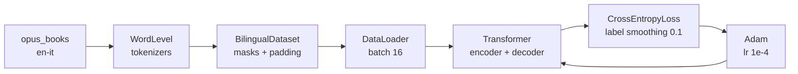

# Transformer From Scratch

A from-scratch PyTorch implementation of the encoder-decoder Transformer from
[Attention Is All You Need](https://arxiv.org/abs/1706.03762), trained for
English → Italian translation on [Helsinki-NLP/opus_books](https://huggingface.co/datasets/Helsinki-NLP/opus_books).

No pretrained models, no `nn.Transformer` — every block is implemented explicitly:
attention, positional encoding, layer norm, feed-forward layers, residual
connections, masking, and the training loop.

## Architecture

| Component | Implementation |
|---|---|
| Input embeddings | `nn.Embedding`, scaled by $\sqrt{d_{model}}$ |
| Positional encoding | Sinusoidal, stored as a non-trainable buffer, applied with dropout |
| Attention | Scaled dot-product with $d_k = d_{model}/h$, padding mask + causal mask |
| Multi-head attention | Separate $W_Q$, $W_K$, $W_V$, $W_O$ projections, `h` heads |
| Feed-forward | Linear → ReLU → Dropout → Linear ($d_{model} \to d_{ff} \to d_{model}$) |
| Residual connection | Pre-norm: `x + dropout(sublayer(norm(x)))` |
| Encoder / decoder | 6 blocks each; decoder adds masked self-attention and cross-attention |
| Output | Linear projection followed by `log_softmax` |
| Initialization | Xavier uniform on all parameters with `dim > 1` |

Defaults from `build_transformer`: `d_model=512`, `N=6`, `h=8`, `d_ff=2048`,
`dropout=0.1`.



## Repository layout

| File | Purpose |
|---|---|
| `model.py` | Transformer building blocks: embeddings, positional encoding, layer norm, feed-forward, multi-head attention, residual connections, encoder/decoder, projection layer, `build_transformer` |
| `dataset.py` | `BilingualDataset` padding/masking and `causal_mask` |
| `config.py` | Hyperparameters, paths, and `get_weights_file_path` |
| `train.py` | Tokenizer construction, dataset loading, training loop, checkpointing, TensorBoard logging |
| `transformer-from-scratch.ipynb` | Self-contained walkthrough: model, data, training, greedy decoding, validation printing, attention heatmaps |
| `attention_visual.ipynb` | Attention visualization notebook that imports the Python modules and loads a trained checkpoint |

## Requirements

- **Python 3.12+** — `train.py` uses nested same-type quotes inside an f-string
  (`f"{config["lang_src"]}-..."`), which requires PEP 701.
- PyTorch 2.x, CPU or CUDA.

There is no lockfile in the repo; install the dependencies directly:

```bash
pip install torch datasets tokenizers tensorboard tqdm altair pandas numpy jupyter
```

Install the CUDA build of PyTorch from [pytorch.org](https://pytorch.org/get-started/locally/)
if you want GPU training.

## Quick start

### Train

```bash
python train.py
```

The first run downloads `Helsinki-NLP/opus_books` (`en-it`), trains two
`WordLevel` tokenizers (`tokenizer_en.json`, `tokenizer_it.json`), and starts
training. Subsequent runs reuse the tokenizer files.

Artifacts:

- `weights/tmodel_` — checkpoint (`epoch`, `model_state_dict`,
  `optimizer_state_dict`, `global_step`)
- `runs/tmodel/` — TensorBoard event files (`train_loss` per step)
- `tokenizer_en.json`, `tokenizer_it.json` — cached tokenizers

### Monitor training

```bash
tensorboard --logdir runs/tmodel
```

### Visualize attention

Open one of the notebooks:

```bash
jupyter notebook transformer-from-scratch.ipynb
jupyter notebook attention_visual.ipynb
```

`attention_visual.ipynb` expects a checkpoint at `weights/tmodel_` and loads it
via `get_weights_file_path`.

## Configuration

All training knobs live in `get_config()` in `config.py`:

| Key | Default | Meaning |
|---|---|---|
| `batch_size` | `16` | Training batch size |
| `num_epochs` | `2` | Number of epochs |
| `lr` | `1e-4` | Adam learning rate (`eps=1e-9`) |
| `seq_len` | `350` | Fixed source/target length (padding/truncation check) |
| `d_model` | `512` | Embedding and model width |
| `lang_src` / `lang_tgt` | `en` / `it` | Language pair |
| `model_folder` | `weights` | Checkpoint directory |
| `model_basename` | `tmodel_` | Checkpoint filename |
| `preload` | `False` | If truthy, resume from `weights/tmodel_` |
| `tokenizer_file` | `tokenizer_{0}.json` | Tokenizer cache path pattern |
| `experiment_name` | `runs/tmodel` | TensorBoard output directory |

`N`, `h`, `d_ff`, and `dropout` are not exposed in the config; they use the
defaults in `build_transformer`.

## Training details

- **Data**: `Helsinki-NLP/opus_books` `en-it` train split, randomly split 90/10
  into train/validation. No seed is fixed, so the split differs between runs.
- **Tokenization**: `WordLevel` with a whitespace pre-tokenizer,
  `min_frequency=2`, and special tokens `[UNK]`, `[PAD]`, `[SOS]`, `[EOS]`.
- **Encoding**: source is `[SOS] … [EOS] [PAD]…`; decoder input is
  `[SOS] … [PAD]…`; labels are shifted right by one position.
- **Masks**: encoder padding mask `(B, 1, 1, S)`; decoder padding mask combined
  with a causal upper-triangular mask, yielding `(B, 1, S, S)`.
- **Loss**: cross-entropy with `ignore_index=[PAD]` and `label_smoothing=0.1`.
- **Optimizer**: Adam, `lr=1e-4`, `eps=1e-9`.


## Reference

- Vaswani et al., *Attention Is All You Need* (NeurIPS 2017):
  <https://arxiv.org/abs/1706.03762>
- Dataset: <https://huggingface.co/datasets/Helsinki-NLP/opus_books>
- Tokenizers: <https://github.com/huggingface/tokenizers>
- Video Tutorial: <https://youtu.be/ISNdQcPhsts?si=xYPHq0OJpJQVTyEv>
